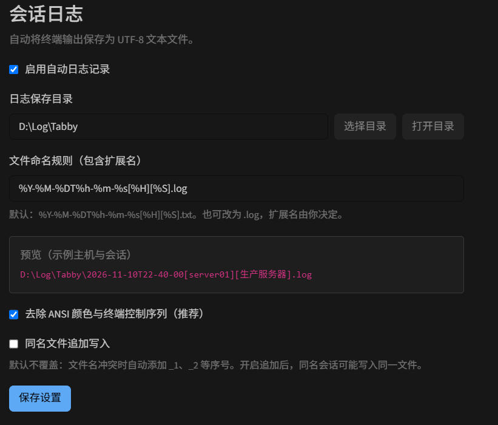

# Tabby Session Logger

**English** | [中文](README.zh-CN.md)

A simple session logging plugin for Tabby Terminal. Choose a log directory, customize filenames with SecureCRT-style placeholders, and save UTF-8 text as `.txt`, `.log`, or any other extension.

**Zero additional runtime or development dependencies.** File operations use built-in Node.js modules. The settings UI reuses Angular and the APIs included with Tabby. No additional Angular, RxJS, translation library, or bundler is installed.



The screenshot shows the Chinese settings UI before the language selector was added.

## Quick start

1. Install the plugin and fully restart Tabby.
2. Open **Settings → Session logs** (Chinese: **设置 → 会话日志**).
3. Choose your language, log directory, and filename pattern.
4. Review the preview and click **Save settings**.

Logging is enabled by default. Files are saved in `TabbyLogs` under your home directory. Default pattern:

```text
%Y-%M-%DT%h-%m-%s[%H][%S].txt
```

Example:

```text
2026-11-10T22-08-05[server01][Production server].txt
```

Use any extension directly in the pattern:

```text
%H_%Y-%M-%D.txt
%S_%Y%M%D_%h%m%s.log
%H_%S.txt
```

Both `.txt` and `.log` contain UTF-8 text. Custom extensions and filenames without extensions are supported. Upgrading preserves saved custom patterns; change an existing `.log` pattern in settings if you want `.txt`.

## Language

The selector provides **Follow Tabby / English / 中文**.

- **Follow Tabby** is the default. Chinese locales, including `zh-CN` and `zh-TW`, use Chinese. English and other locales use English.
- **English** or **中文** overrides the plugin language without changing Tabby's language.
- The settings page previews your choice immediately. Click **Save settings** to persist it. In follow mode, the page updates when Tabby's language changes.
- Settings labels, sidebar title, placeholder descriptions, validation messages, and logging notifications are localized. Original operating-system error details remain available for troubleshooting.
- Changing only the language does not interrupt, rotate, or rename existing logs. Session names and terminal output are not translated.

## Filename placeholders

These placeholders are similar to SecureCRT's syntax; not every SecureCRT naming rule is implemented. Tokens are case sensitive.

| Token | Meaning | Example |
| --- | --- | --- |
| `%H` | Configured SSH/Telnet destination; local hostname for local terminals | `server01` |
| `%S` | Tabby profile/session name, falling back to the tab title | `Production server` |
| `%Y` | Four-digit year | `2026` |
| `%y` | Two-digit year | `26` |
| `%M` | Month, 01–12 | `11` |
| `%D` | Day, 01–31 | `10` |
| `%h` | Hour, 00–23 | `22` |
| `%m` | Minute, 00–59 | `08` |
| `%s` | Second, 00–59 | `05` |
| `%%` | Literal percent sign | `%` |

Dates use your local timezone and are fixed when each log starts; there is no midnight rotation. `%H` uses the configured destination without querying the remote hostname.

The pattern accepts a filename only. Put subdirectories in **Log directory**, using an absolute path or `~/`. Invalid characters in host/session values, including IPv6 colons, become underscores. Invalid patterns, reserved names, and overly long filenames are rejected.

## Logging behavior

- Records SSH, local terminal, Telnet, and serial output exposed through Tabby's terminal API. Reconnecting creates a new log.
- By default, files are created exclusively. Collisions add `_1`, `_2`, etc., preserving existing files. Optional append mode can mix sessions that resolve to the same path.
- Removes ANSI colors, cursor controls, and OSC/DCS sequences by default. Handles split sequences and UTF-8 characters across chunks. Disable filtering to retain control codes.
- Saving changed logging options starts new logs for open sessions. Language-only changes leave logs running. Disabling stops logging; normal session closure drains accepted output.
- Records output only, without separately capturing keystrokes. Echoed commands appear in logs; non-echoed passwords are not captured from the keyboard.
- This is a text transcript, not a screen recording. Vim/top, progress bars, and backspace edits are not reconstructed. CR/LF and tabs are retained.
- Earlier output is not recovered. Logging in deferred or unseen tabs depends on when Tabby initializes the terminal and attaches decorators.
- Write errors stop the affected log and show a notification without disconnecting the terminal. Pending writes are capped at 8 MiB; logging stops if storage cannot keep up.
- Normal closure drains queued writes. Forced termination, crashes, or power loss may lose the final buffered output. This is a UTF-8 logger, not a binary transfer recorder.

## Build and local installation

Requires **Node.js 18+** for development. From the source directory:

```sh
npm test
npm run build
npm run install:local
```

**No `npm install` is needed.** The build checks native CommonJS JavaScript syntax, assembles `dist`, and copies `src/ScreenShot.jpg` to `docs/ScreenShot.jpg`. No compiler or bundler dependencies are required.

The installer copies built modules, package metadata, both READMEs, screenshot, and license. Default Windows destination:

```text
%APPDATA%\tabby\plugins\node_modules\tabby-session-logger
```

For another location, pass the full plugin directory, ending with `tabby-session-logger`:

```sh
node scripts/install.js "C:\path\to\tabby\plugins\node_modules\tabby-session-logger"
```

Tabby scans for packages with the `tabby-plugin` keyword; other plugins and Tabby configuration files are not edited. Package-manager operations may prune manually copied plugins; rerun `npm run install:local` if necessary.

```text
src/index.js          Tabby module, settings UI, session lifecycle
src/logging.js        Naming, ANSI filtering, asynchronous writes
src/i18n.js           English/Chinese dictionaries and language selection
src/ScreenShot.jpg    Original screenshot
docs/ScreenShot.jpg   Documentation screenshot copied by the build
scripts/build.js      Dependency-free build
scripts/install.js    Local installer
test/                 Built-in Node.js tests
dist/                 Loadable plugin modules
```

## Compatibility and verification

Integration targets the installed **Tabby 1.0.238** APIs, including its locale service. Tests cover logging, asynchronous UI updates, language resolution/persistence, localized messages, and language changes without log rotation.

Host integration tests use substitutes for Tabby services, so they do not replace verification in a real window. Restart Tabby after installation and check **Session logs** with a new terminal. Other versions have not all been tested.

To stop logging, disable it in settings. To uninstall, close Tabby and remove the installed plugin directory. Existing logs are retained.

## Changes

- **1.1.0:** English/Chinese UI with follow-Tabby default, localized errors, English README linking to Chinese, and screenshots in both documents. No new dependencies.
- **1.0.1:** Fixed the saving indicator after asynchronous work, prevented duplicate saves, and set the default pattern to `%Y-%M-%DT%h-%m-%s[%H][%S].txt`.

## License

MIT
