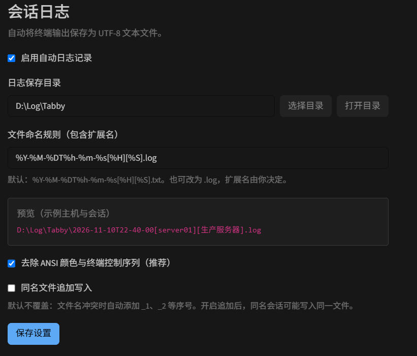

# Tabby Session Logger

[English](README.md) | **中文**

简单的 Tabby 会话日志插件。支持设置日志保存目录、自定义文件命名规则，以及 `.txt`、`.log` 等任意扩展名。

**零新增第三方运行依赖、零开发依赖**：文件写入使用 Node.js 内置模块；设置界面和会话接口复用 Tabby 自带的 Angular、tabby-core、tabby-terminal 和 tabby-settings。无需安装另一份 Angular 或 RxJS。



截图为已有中文界面，拍摄于新增语言选择框之前。

## 界面语言

在设置页选择 **跟随 Tabby / English / 中文**，点击 **保存设置**。

- 默认 **跟随 Tabby**：Tabby 为中文（包括 `zh-CN`、`zh-TW` 等）时显示中文，英文及其他语言时显示 English。
- 选择 English 或中文后，插件固定使用所选语言，不改变 Tabby 本身的语言。
- 选择后立即预览，保存后持久化；跟随模式下，设置页会响应 Tabby 的语言切换。
- 设置页、侧栏标题、占位符说明、校验和日志错误提示均提供中英文。系统错误的原始详情保留，便于排查。
- 仅修改语言不会关闭、重建或重命名正在写入的日志；会话名称和日志正文保持原样。

## 使用

1. 安装插件后，完全退出并重新打开 Tabby。
2. 打开 **设置 → 会话日志**（英文为 **Settings → Session logs**）。
3. 输入或选择日志保存目录，填写包含扩展名的文件命名规则。
4. 查看示例路径，点击 **保存设置**。

默认启用自动记录，日志保存到用户主目录下的 `TabbyLogs`（本机为 `C:\Users\jiang\TabbyLogs`）。默认规则：

```text
%Y-%M-%DT%h-%m-%s[%H][%S].txt
```

示例：

```text
2026-11-10T22-08-05[server01][生产服务器].txt
```

默认使用 `.txt`，也可以改为 `.log`，不需要另外选择文件类型：

```text
%H_%Y-%M-%D.txt
%S_%Y%M%D_%h%m%s.log
%H_%S.txt
```

`.txt` 和 `.log` 都是 UTF-8 文本，仅文件扩展名不同。支持无扩展名和其他后缀。

升级不会覆盖已经保存的自定义命名规则。如之前保存的是 `.log`，请在设置中改为上面的 `.txt` 规则并保存。

### 1.1.0 更新

加入可配置中英文和跟随 Tabby 语言；默认英文 README，顶部链接切换中文，两个版本均展示 `ScreenShot.jpg`。保持零新增依赖。

### 1.0.1 修复

修复异步保存完成后界面仍停留在“正在保存”的问题：Node.js 原生异步操作结束后，显式进入 Angular 的界面更新流程。保存成功、失败和选择目录都会刷新界面；保存期间阻止重复提交，关闭设置页后不再刷新已销毁的视图。默认命名改为 `%Y-%M-%DT%h-%m-%s[%H][%S].txt`。

## 命名占位符

采用类似 SecureCRT 的占位符，区分大小写；不承诺兼容 SecureCRT 的所有规则。

| 占位符 | 含义 | 示例 |
| --- | --- | --- |
| `%H` | SSH/Telnet 配置中的目标主机；本地终端为本机主机名 | `server01` |
| `%S` | Tabby 配置中的会话名称；缺失时使用标签标题 | `生产服务器` |
| `%Y` | 四位年份 | `2026` |
| `%y` | 两位年份 | `26` |
| `%M` | 月份，01–12 | `11` |
| `%D` | 日期，01–31 | `10` |
| `%h` | 小时，00–23 | `22` |
| `%m` | 分钟，00–59 | `08` |
| `%s` | 秒，00–59 | `05` |
| `%%` | 百分号 | `%` |

日期使用本机时区，在每次日志开始时确定，不按午夜自动切换文件。SSH 的 `%H` 使用连接配置中的地址，不额外登录服务器查询 hostname。命名规则只接受文件名；子目录请填写到“日志保存目录”中。目录需要绝对路径或 `~/` 开头。

主机名、会话名中的路径分隔符和 Windows 非法字符会替换成下划线。IPv6 地址中的冒号也会被替换。未知占位符、过长文件名和系统保留名称会报错。

## 记录行为

- 自动记录 SSH、本地终端、Telnet、串口等由 Tabby 终端会话接口提供的输出。SSH 自动重连时创建新的日志。
- 默认文件名冲突时使用 `_1`、`_2` 等序号，原子创建文件，不覆盖已有内容。
- 可选择“同名文件追加写入”；此时相同路径的会话可能混写，请按需要在命名中加入 `%S` 和时间。
- 默认去除 ANSI 颜色、光标控制、OSC/DCS 等控制序列。支持跨数据块的控制序列及 UTF-8 中文/表情。关闭该选项会保留文本中的控制码。
- 保存设置立即生效；日志选项有变化时，为已打开会话重新开始记录，仅修改语言不影响日志。禁用并保存会停止记录。切换会话、关闭标签时会异步写完已接收的数据并关闭文件。
- 仅订阅终端输出，不额外监听键盘；远端回显的命令也会出现在日志里。不回显的密码不会通过键盘采集加入日志。
- 日志是连续文本记录，不是终端屏幕录像。Vim、top、进度条、退格编辑等内容不会按屏幕布局重建；保留 CR/LF 和制表符。
- 不补录插件启用之前的输出。Tabby 延迟初始化或尚未显示的标签，何时开始记录取决于宿主创建终端和触发装饰器的时间。
- 写入失败会在 Tabby 中提示，并停止该次日志，不影响终端连接。待写队列最多 8 MiB；磁盘跟不上时提示并停止记录，防止内存无限增长。
- 正常会话结束会排空写入队列；进程强制结束、系统崩溃或断电时，不保证最后一段尚未写入的数据持久化。保留 ANSI 的选项仍是 UTF-8 文本记录，不用于保存二进制传输文件。

## 源码与安装目录

源码结构：

```text
src/index.js              Tabby 模块、设置界面、会话生命周期
src/logging.js            文件名规则、ANSI 过滤器、异步日志写入
src/i18n.js               本地中英文字典和语言选择规则
src/ScreenShot.jpg        原始截图
docs/ScreenShot.jpg       构建时复制，用于 README 和安装包
scripts/build.js         语法检查和构建
scripts/install.js       构建并安装到本机 Tabby
test/                    Node.js 内置测试，无额外测试框架
dist/                    构建产物
```

使用 Node.js 18 或以上版本，在源码目录运行：

```powershell
npm test
npm run build
npm run install:local
```

**无需运行 `npm install`。** 源码使用可直接执行的 CommonJS JavaScript，所以构建进行语法检查并生成 `dist`，不依赖 TypeScript、Webpack 或压缩工具。安装目录包含 `dist`、`package.json`、中英文 README、截图和 `LICENSE`。

自定义安装路径（完整路径必须以 `tabby-session-logger` 结尾）：

```powershell
node scripts/install.js "C:\path\to\tabby\plugins\node_modules\tabby-session-logger"
```

Tabby 会扫描插件目录下带有 `tabby-plugin` 关键字的包，无需修改其他插件和 Tabby 配置文件。通过插件管理器安装/卸载其他插件时，包管理器可能清理手动复制的插件；如遇到此情况，重新运行 `npm run install:local`。

## 验证与兼容性

针对本机 Tabby **1.0.238** 的已安装源码/API 核对加载方式、设置页接口、语言服务和终端会话生命周期。自动测试覆盖日志功能、异步界面更新、中英文切换、跟随宿主语言、语言设置持久化和切换语言不中断日志。

自动测试中的宿主接口使用替身，不等同于真实 Tabby 窗口验证。安装后请重启 Tabby，在设置中确认“会话日志”页，并打开一个新终端确认日志生成。README 中的版本不代表已测试所有其他 Tabby 版本。

可在设置中关闭记录；卸载时关闭 Tabby 后删除安装目录即可，已有日志文件不受影响。

## License

MIT
